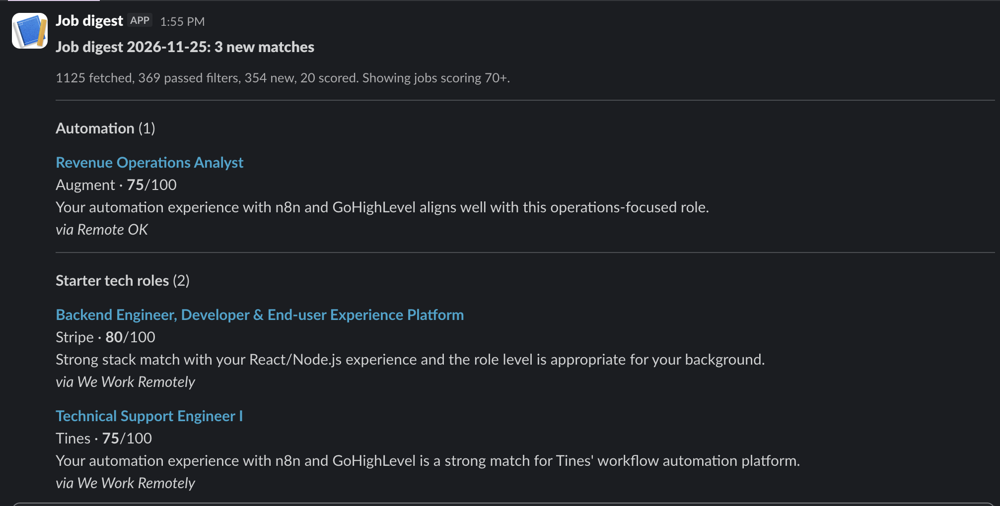
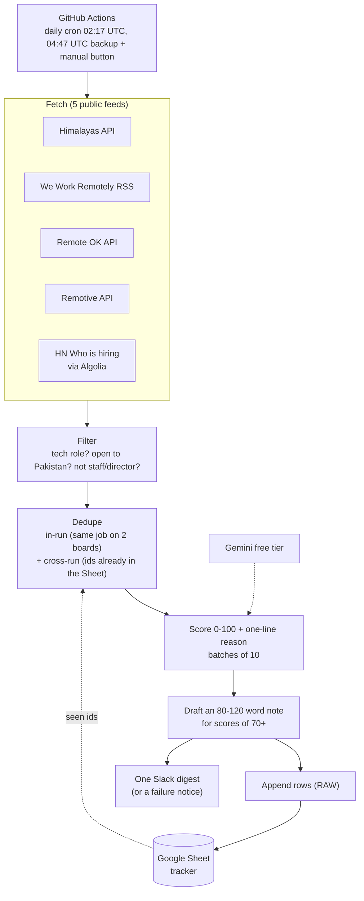

# Job Agent

[](https://github.com/ibrahimsaadqureshi/job-agent/actions/workflows/tests.yml)
[](https://github.com/ibrahimsaadqureshi/job-agent/actions/workflows/daily.yml)

A free daily pipeline that finds remote tech jobs open to candidates in **Pakistan**, scores
them against a resume with a free LLM, drafts short application notes, tracks everything in
a Google Sheet and sends one Slack digest every morning. A human reads every job and applies
by hand. There is no auto-apply.

It runs on GitHub Actions every morning (07:17 Pakistan time, with a 09:47 backup), needs no server, and costs nothing: every
service it uses is on a free tier with no billing attached.



## Why

Most "remote" jobs aren't remote for everyone. On a typical day about two thirds of the
listings on the big remote boards are locked to the US, Europe or a single country, and the
lock is often buried in the description ("must be authorized to work in...", "US-based",
"W-2"). Checking hundreds of listings by hand for the few that are actually open to someone
in Pakistan, and then judging which of those are realistic, takes hours a day. This
pipeline does the sorting so the human time goes into applying.

## How it works



1. **Fetch** about 1,100 listings a day from five boards. Every request sends an honest
   User-Agent, a timeout and one retry. A board that fails is reported and skipped; it never
   stops the run.
2. **Filter** with plain, unit-tested rules (below). About a third survive.
3. **Dedupe** by canonical URL and by a company + title fingerprint. The Sheet is the only
   state: at start-up the run reads its `id` column, so the Actions runner needs no database
   and never commits state back to the repo.
4. **Score** each new job with an LLM against a contact-stripped profile, then **draft** a
   note for the good ones.
5. **Track** every scored job as a new row in the Sheet, and **send** one digest to Slack.

## Sources and attribution

| Board | Feed | Attribution |
|---|---|---|
| [Himalayas](https://himalayas.app) | Public search API, `country=Pakistan` and `worldwide=true` | Each job links to its Himalayas page and is credited "via Himalayas". |
| [We Work Remotely](https://weworkremotely.com) | Public RSS feeds | Links to the WWR listing, credited "via We Work Remotely". |
| [Remote OK](https://remoteok.com) | Public JSON API | Its terms require a link back to the Remote OK URL and naming Remote OK as the source: both are in every Sheet row (`source`, `link`) and every digest entry. |
| [Remotive](https://remotive.com) | Public JSON API | Its terms require a link back and credit, and forbid republishing to other job boards. Jobs are only sent to one private Slack channel and Sheet. |
| [HN "Who is hiring"](https://news.ycombinator.com/submitted?id=whoishiring) | Algolia HN API | Links to the original HN comment, credited "via HN Who is hiring". |

Only public APIs and feeds are used. Nothing is scraped, and there's no login anywhere.

## Filtering

All rules match whole words, not substrings (so "ai" doesn't match "maintain"), and each has
a table of real-world cases in the tests.

- **Category** (decides the digest section): `stack` (TypeScript, React, Node and friends),
  `automation` (n8n, Zapier, Make, CRM/RevOps engineering, integrations) and `tech-entry`
  (any other technical role that's entry-level or open to learning: other languages, QA,
  support engineering, junior DevOps, data analyst, technical writing...). Sales, marketing,
  recruiting, finance and other non-technical roles are dropped before any LLM call.
- **Location**: pass for worldwide, anywhere, global, Asia/APAC, EMEA, Middle East, South
  Asia, Pakistan, a restriction list that includes Pakistan, or a timezone range covering
  UTC+5. Drop for "US/UK/EU/LATAM only", country lists without Pakistan, named cities, and
  work-authorization phrases in the description ("must be authorized to work in", "US
  citizens", "security clearance", "W-2"). The reason a job passed is kept in the
  `location rule` column.
- **Seniority**: staff, principal, director, head of, VP and manager titles are dropped.
  Senior roles are kept and left to the scorer, which weighs them against the candidate's
  real experience.

## Scoring and drafts

- **Model:** Google `gemini-3.1-flash-lite` on the free tier (15 requests/minute, 500/day).
  The client paces itself at one call every 6 seconds, retries a 429/5xx once, and stops
  using a provider for the rest of the run once its quota is gone.
- **When the LLM fails:** jobs it couldn't score aren't written to the Sheet, so the next
  run retries them. Nothing is lost, only delayed a day. The code has a provider chain (it
  tries the next configured provider before giving up) with **GitHub Models** and a local
  **Ollama** as alternatives, but GitHub retired its free Models service in 2026, so in
  Actions the chain is Gemini alone (see Limits).
- **Scoring:** 10 jobs per request, each trimmed to about 1,000 characters. The rubric asks
  three questions: can they get hired (level and years vs. real experience, region), can
  they ramp up fast (how close the stack is, mentoring), and will they grow. Hard caps are
  enforced in code as well as in the prompt: 5+ years asked caps the score at 40, 7+ at 25,
  and talent-pool agencies that mass-post identical roles are capped at 30.
- **Output validation:** JSON with a schema. The validator drops unknown or duplicate ids,
  out-of-range scores and empty reasons, accepts `"85"` and `85.0`, strips code fences and
  prose, and salvages complete items from truncated JSON. Unusable output gets one retry,
  then the next provider.
- **Drafts and anti-hallucination rules.** A note is drafted only for scores of 70 or more,
  at most 12 a run. The prompt forbids, among other things:
  - claiming any skill, tool, year or result the profile doesn't state;
  - presenting related experience as direct experience (a missing skill may be named once,
    plainly, as new);
  - inventing numbers, employers, titles, dates or users;
  - claiming time-zone overlap, availability or work authorization;
  - stock phrases ("I am excited to apply", "passionate", "perfect fit"...).

  During the build, every skill and project cited in the live test drafts was checked against
  the profile.

## Privacy and secrets

The repo and its Actions logs are public, so the design assumes everything printed is read
by strangers.

- **Logs carry counts only.** A production run prints lines like
  `fetched=1125 kept=369 new=354 scored=200 drafted=9 written=200`. Job text, scores,
  reasons, drafts, the profile, the Sheet id and the webhook are never printed. Errors are
  reported by exception type only, and noisy HTTP loggers (which can print URLs) are pinned
  to WARNING. GitHub's secret masking is a second layer, not the only one.
- **The resume is never committed.** Locally it's read from a path outside the repo, and in
  CI from the `CANDIDATE_PROFILE` secret. Emails, phone numbers, links and the name line are
  stripped **before** any text reaches an LLM; the free Gemini tier may use inputs to improve
  Google's products, so only skills, experience and public job text are sent.
- **Sheet writes are `RAW`.** A job title starting with `=` stays text and can't run as a
  formula. The pipeline only appends rows: it never edits existing ones, so a human's
  `status` edits are safe.
- **Slack:** job text is escaped, non-http links are dropped, and the webhook is called
  without urllib3's retry adapter, whose warnings would print the URL path (the secret).
- **Least-privilege workflows:** the daily run has only `contents: read`; only the
  keepalive has `actions: write`.

## Setup

You need Python 3.11+, the [GitHub CLI](https://cli.github.com) and four free accounts. All
local secrets live in one folder **outside** the repo, `~/.config/job-agent/`, so they
survive new clones and can't be committed by accident.

1. **Install**
   ```bash
   python3 -m venv .venv
   .venv/bin/pip install -e '.[dev,sheets,resume]'
   mkdir -p ~/.config/job-agent
   cp .env.example ~/.config/job-agent/.env
   cp config.toml.example ~/.config/job-agent/config.toml   # set resume_path
   ```
2. **Keys** (paste each into `~/.config/job-agent/.env`):
   - `GEMINI_API_KEY`: [aistudio.google.com](https://aistudio.google.com) → Get API key. Don't attach billing.
   - `GOOGLE_SERVICE_ACCOUNT_JSON`: a Google Cloud service account with the Sheets API
     enabled; paste its JSON key as one line.
   - `SHEET_ID`: a blank Google Sheet shared (Editor) with the service account's email.
   - `SLACK_WEBHOOK_URL`: a Slack app with an incoming webhook to a `#jobs` channel.
3. **Format the Sheet once:** `python -m jobagent setup-sheet` (bold frozen header, hidden
   `id`, score colours, a `status` dropdown, a filter). Safe to re-run.
4. **Try it locally:** `python -m jobagent run --dry-run --limit 5`.
5. **Copy the secrets to GitHub (Step D):** `bash scripts/setup_secrets.sh`. It reads the
   `.env` file and the stripped profile and sets each Actions secret with `gh secret set`,
   feeding values on stdin. It prints only `set NAME` and refuses to run if any value is
   empty.

Section 6 of [PLAN.md](PLAN.md) has the click-by-click version of step 2.

## Usage

```
python -m jobagent run [--dry-run | --local] [--no-llm] [--limit N] [--sources a,b] [-v]
python -m jobagent setup-sheet     # one-time Sheet formatting
python -m jobagent profile         # print the contact-stripped profile (for the secret)
python -m jobagent sources         # list the boards
```

| Flag | What it does |
|---|---|
| *(none)* | Production: read seen ids from the Sheet, append rows, send the Slack digest. |
| `--dry-run` | Fetch, filter, dedupe against local state and score, then print the rows and digest. Writes and sends nothing. |
| `--local` | Like `--dry-run`, but records rows in `~/.config/job-agent/state/`, so a second run dedupes. |
| `--no-llm` | Skip scoring and drafting (zero LLM cost). |
| `--limit N` | Score at most N jobs this run (default 200), so a backlog spreads over a few days. |
| `--sources a,b` | Only these boards, e.g. `--sources wwr,remotive`. |

Tuning lives in environment variables: `SCORE_THRESHOLD` (default 70), `DIGEST_MAX_JOBS`
(12), `MAX_SCORED_PER_RUN` (200), `LLM_PROVIDER` (`gemini`, or `ollama` for local runs). See [.env.example](.env.example).

## GitHub Actions

- **[`daily.yml`](.github/workflows/daily.yml):** two crons, `17 2 * * *` and a backup at
  `47 4 * * *`. Both sit off the hour because GitHub can drop scheduled runs at busy times
  (the first one at `0 3` was dropped). A small `check` job skips the backup when a run
  already succeeded that day, so there's one digest a day. Plus a manual **Run workflow**
  button with an optional `--limit`. A concurrency group stops two runs overlapping; 30-minute timeout.
- **[`keepalive.yml`](.github/workflows/keepalive.yml):** GitHub disables scheduled
  workflows in public repos after 60 days without activity. Twice a month this re-enables
  both scheduled workflows through the REST API, which resets that counter, with no dummy
  commits.
- **[`tests.yml`](.github/workflows/tests.yml):** pytest on every push and pull request.

If a run crashes, the digest channel gets a short failure notice naming only the error type,
and the run is marked failed. If nothing new scores 70+, a one-line "nothing new today"
message is sent with the counts, so silence always means something broke.

## Testing

```bash
.venv/bin/python -m pytest
```

340 tests, with **no network**: every outside service (boards, LLMs, Sheets, Slack) sits
behind a small interface with an in-memory fake in `tests/fakes.py`. Parsers run against
trimmed real responses saved from each board. The location rules are checked against a
table of real location strings, and the LLM validator against real malformed outputs.

## Code layout

```
jobagent/
  cli.py          commands and run modes
  pipeline.py     fetch -> filter -> dedupe -> score -> draft -> track -> digest
  sources/        one module per board: a pure parse() plus a thin fetch()
  filters.py      category, location, seniority and work-authorization rules
  dedupe.py       canonical URLs and company/title fingerprints
  scorer.py       batching, validation, caps, drafts
  llm/            Gemini, GitHub Models and Ollama providers + the fallback chain
  prompts/        score.txt, draft.txt
  profile.py      resume text extraction and contact stripping
  sheet.py        Google Sheet tracker and setup-sheet
  slack.py        Block Kit digest and failure notice
  config.py       every setting in one place
tests/            pytest suites, fixtures and fakes
```

## Limits and next steps

- Free tiers set the pace: about 200 jobs scored a day, so the first backlog takes two days.
- Gemini occasionally returns 503 or times out under load. Those jobs wait for the next run.
  A second free provider in Actions would close that gap: GitHub Models was the plan, but it
  was retired before this went live (verified from Actions: its endpoint now answers every
  request with a plain `OK`). The best candidate is a second Gemini model as a fallback,
  since free-tier quotas are per model.
- Sources considered and deferred: **Wellfound**, **YC Work at a Startup** and **Arc.dev**
  have no public API and restrict automated access, so they're out. Candidates with
  legitimate public APIs for later: **Jobicy** (has geo filters) and Greenhouse, Lever and
  Ashby board APIs for a hand-picked list of remote-first companies that hire in Asia.
- Ideas: track which applications got replies and feed that back into the rubric; a weekly
  summary of what the market asked for.

## History

v1 (still in git history) was a set of scripts that scraped two boards into SQLite and
ranked them with a local Ollama model. v2 is a rewrite around location eligibility, a hosted
free LLM, a Sheet as the only state, and a test suite. [PLAN.md](PLAN.md) is the design
document and build log.
